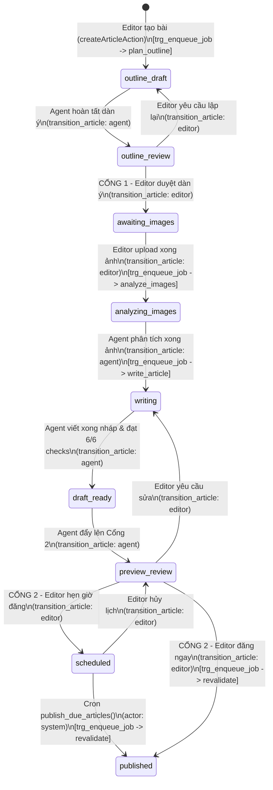

# PHASE 0 — BASELINE AUDIT (CONTENT SEO AGENT V2)

> **Ngày kiểm toán**: 2026-11-18
> **Phạm vi**: Kiểm toán toàn diện kiến trúc, cơ sở dữ liệu, cấu trúc bài viết, bộ kiểm tra tự động và kiểm thử hồi quy của hệ thống Content SEO Agent V1 trước khi nâng cấp lên V2.
> **Cam kết Phase 0**: Không chỉnh sửa bất kỳ logic nghiệp vụ hay cơ sở dữ liệu nào.

---

## 1. Kiến Trúc Hiện Tại ( mục 4.A )

### 1.1. Các Route & Trang Giao Diện (Next.js App Router)

| Nhóm | Đường dẫn Route | File nguồn | Chức năng chính |
| :--- | :--- | :--- | :--- |
| **Public** | `/` | `app/page.tsx` | Trang chủ giới thiệu hệ thống Demo Content Agent. |
| **Public** | `/blog` | `app/blog/page.tsx` | Danh sách bài viết có `status = 'published'`. |
| **Public** | `/blog/[slug]` | `app/blog/[slug]/page.tsx` | Trang đọc bài công khai, nhúng `<script type="application/ld+json">` và render qua `<ArticleRenderer>` (`R-41`). |
| **Public** | `/robots.txt` | `app/robots.txt/route.ts` | Cho phép các AI/Search crawlers (`Googlebot`, `GPTBot`, `ClaudeBot`, `PerplexityBot`, `Google-Extended`) và chặn `/admin/` (`R-39`). |
| **Public** | `/llms.txt` | `app/llms.txt/route.ts` | Xuất tóm tắt thương hiệu (`brand_profile`) + danh sách bài `published` định dạng Markdown (`R-40`). |
| **Auth** | `/login` | `app/login/page.tsx` | Đăng nhập Supabase Auth hoặc chuyển nhanh vai trò Demo (`admin`/`editor`). |
| **Admin** | `/admin` | `app/admin/page.tsx` | Tổng quan bảng điều khiển quản trị. |
| **Admin** | `/admin/articles` | `app/admin/articles/page.tsx` | Danh sách bài viết, tạo bài mới theo `topic`, nút AI tự động lập lịch & dàn ý 3 bài, nút chạy Dev Worker và đăng bài đến hạn. |
| **Admin** | `/admin/articles/[id]` | `app/admin/articles/[id]/page.tsx` | Chi tiết bài viết theo từng trạng thái: **Cổng 1 (`outline_review`)**, Upload ảnh (`awaiting_images`), **Cổng 2 (`preview_review`)**, báo cáo `check_report`, lịch sử `article_events`. |
| **Admin** | `/admin/brand` | `app/admin/brand/page.tsx` | Quản lý hồ sơ thương hiệu (`brand_profile`: tên, mô tả, giọng văn, `products`, `facts`, `forbidden_claims`). |
| **Admin** | `/admin/settings/ai` | `app/admin/settings/ai/page.tsx` | Cấu hình `provider` (`anthropic`/`openai`), `model_writer`, `model_vision`, `monthly_token_budget` và lưu API Key vào Supabase Vault (`R-42`). |

### 1.2. API Endpoints & Server Actions

#### API Routes (dành cho Cron / Edge Trigger):
- `POST /api/agent/worker` (`app/api/agent/worker/route.ts`): Bảo vệ bằng header `x-worker-secret` khớp `process.env.AGENT_WORKER_SECRET`. Gọi `processNextAgentJob()`.
- `POST /api/publish-due` (`app/api/publish-due/route.ts`): Bảo vệ bằng header `x-worker-secret`. Gọi RPC `publish_due_articles()` và `revalidatePath("/blog")`.

#### Server Actions:
- `app/admin/articles/actions.ts`:
  - `createArticleAction`: Tạo bản ghi `articles` (mặc định `status = 'outline_draft'`) và gọi ngay `processNextAgentJob()`.
  - `aiAutoScheduleAndPlanAction`: Tạo 3 bài mẫu từ `brand_profile` và chạy `plan_outline` đưa thẳng tới Cổng 1 (`outline_review`).
  - `runPendingWorkerJobAction`: Thực thi 1 job từ hàng đợi `agent_jobs`.
  - `triggerPublishDueAction`: Gọi RPC `publish_due_articles()`.
- `app/admin/articles/[id]/actions.ts`:
  - `saveOutlineReviewAction`: Cho phép `editor`/`admin` chỉnh sửa và lưu `primary_keyword`, `secondary_keywords`, `faq_questions`, `outline` (JSON) tại Cổng 1 (`outline_review`).
  - `transitionArticleAction`: Gọi RPC `transition_article(p_article_id, p_to, p_expected_version, p_actor_kind: 'editor', p_note)`. Khi chuyển sang bước của Agent (`outline_draft`, `analyzing_images`, `writing`), tự động kích hoạt `processNextAgentJob()`.
  - `uploadArticleImageAction` & `uploadDemoSampleImageAction`: Dùng `sharp` tính `sha256`, chặn ảnh trùng trong cùng bài (`R-13`), tạo bản phân tích JPEG cạnh dài `<= 1568px` (`R-10`, `R-11`), upload lên bucket `article-images` và ghi bảng `article_assets`.

### 1.3. Worker, Hàng Đợi `pgmq` & Các Bước Xử Lý Bài Viết

Worker (`lib/agent/worker.ts`) đọc từng thông điệp từ hàng đợi `pgmq` (`agent_jobs`) thông qua RPC `agent_pop_job()` và xác nhận hoàn tất qua `agent_ack_job(p_msg_id)`.

4 bước xử lý trong Worker (`PoppedJobRow["message"]["step"]`):

1. **`plan_outline`** (ứng với `status = 'outline_draft'`):
   - Lấy gợi ý từ khóa qua `createKeywordProvider()` (`lib/keywords/provider.ts`), loại trùng và giới hạn tối đa 30 từ khóa (`R-01`, `R-04`).
   - Nạp quy tắc `loadRules("plan")` + `brand_profile` làm `systemCacheablePrefix` (`R-16`).
   - Gọi `llm.generateStructured` với `PlanOutlineOutputSchema` để sinh `primary_keyword`, `secondary_keywords` (≤ 8), `faq_questions` (1–6), `outline` (≥ 2 H2 kèm `key_points` và `fact_ids`), và `needs_info`.
   - Cập nhật bảng `articles` và gọi RPC `transition_article` chuyển sang `outline_review` (**Cổng 1**).
2. **`analyze_images`** (ứng với `status = 'analyzing_images'`):
   - Đọc danh sách `article_assets` của bài viết.
   - Kiểm tra cache theo `sha256` trên toàn bảng `article_assets` (`R-13`): nếu đã có `analysis`, tái sử dụng ngay (0 token).
   - Nếu chưa có cache, tải bản `analysis_path` (JPEG `<= 1568px`), gọi `llm.analyzeImage` với `loadRules("image")`, sau đó lọc qua `sanitizeAndValidateImageAnalysis` (`R-12`, `R-17` — xóa tên thương hiệu/sản phẩm nếu không có trong `visible_text`).
   - Gọi RPC `transition_article` chuyển sang `writing`.
3. **`write_article`** (ứng với `status = 'writing'`):
   - Nạp `loadRules(["write", "schema"])` + `brand_profile` vào `systemCacheablePrefix` (`R-16`).
   - Gọi `llm.generateStructured` với `WriteArticleOutputSchema` để sinh `seo` (`title`, `meta_description`), `content_blocks` và `needs_info`.
   - Chạy bộ 6 kiểm tra xác định bằng code `runAllArticleChecks()` (`lib/checks/index.ts`).
   - Nếu trượt và `needs_info` rỗng, cho phép thử lại tối đa `WRITER_CHECK_MAX_RETRIES = 1` lần kèm danh sách lỗi (`R-34`). Nếu `needs_info` khác rỗng, dừng ngay để tránh AI tự bịa dữ liệu (`R-31`, `R-34`).
   - Nếu đạt cả 6/6 kiểm tra: cập nhật `checks_passed = true`, chuyển trạng thái qua RPC `transition_article`: `writing` → `draft_ready` → `preview_review` (**Cổng 2**).
4. **`revalidate`** (ứng với `status = 'published'`):
   - Gọi `revalidatePath("/blog")` và `revalidatePath("/blog/[slug]")`, sau đó `agent_ack_job`.

### 1.4. Cơ Sở Dữ Liệu Supabase, Bảng, Trigger & RPC (`supabase/migrations/`)

#### Danh sách 9 bảng trong schema `public`:
1. `profiles (id uuid PK, role text check in ('admin', 'editor'))`
2. `ai_settings (id boolean PK default true, provider, model_writer, model_vision, api_key_secret_id uuid, api_key_last4, monthly_token_budget, updated_by, updated_at)` — Singleton (1 dòng).
3. `brand_profile (id boolean PK default true, brand_name, description, products jsonb, voice, facts jsonb, forbidden_claims text[], updated_by, updated_at)` — Singleton (1 dòng).
4. `articles (id uuid PK, topic, slug unique, planned_publish_at, status article_status, version int, primary_keyword, secondary_keywords text[], faq_questions text[], outline jsonb, content_blocks jsonb, seo jsonb, checks_passed boolean, check_report jsonb, scheduled_at, published_at, last_error, created_by, created_at, updated_at)`
5. `article_assets (id uuid PK, article_id FK -> articles, storage_path, analysis_path, sha256, width, height, alt_text, analysis jsonb, analyzed_at, created_by, created_at, UNIQUE(article_id, sha256))`
6. `article_versions (id uuid PK, article_id FK -> articles, version int, outline jsonb, content_blocks jsonb, seo jsonb, created_by, created_at)` — Tự động lưu snapshot khi bài vào `outline_review` hoặc `preview_review`.
7. `article_events (id bigint PK, article_id FK -> articles, from_status, to_status, actor, actor_kind, note, created_at)` — Nhật ký kiểm toán (audit log).
8. `keyword_cache (keyword, source, lang, country, results jsonb, fetched_at, PK(keyword, source, lang, country))` — Lưu cache từ khóa 30 ngày (`R-03`).
9. `ai_runs (id bigint PK, article_id FK -> articles, step, model, input_tokens, output_tokens, cost_usd, created_at)` — Nhật ký tiêu thụ token (`R-38`).
10. `article_transitions (from_status, to_status, actor_kind, PK(from_status, to_status, actor_kind))` — Bảng ma trận chuyển trạng thái hợp lệ.

#### Các hàm RPC & Trigger trọng yếu:
- `transition_article(p_article_id, p_to, p_expected_version, p_actor_kind, p_note)`:
  - Kiểm tra quyền (`service_role` chỉ được đóng vai `agent` hoặc `system`; người dùng đăng nhập phải thỏa `is_editor()`).
  - Khóa dòng `SELECT ... FOR UPDATE` và kiểm tra khóa lạc quan `a.version <> p_expected_version`.
  - Đối chiếu bảng `article_transitions`.
  - Kiểm tra điều kiện tiên quyết: sang `analyzing_images` phải có ít nhất 1 ảnh; sang `writing` (bởi `agent`) mọi ảnh phải có `analyzed_at`; sang `preview_review` (bởi `agent`) phải có `checks_passed = true`; sang `scheduled` phải có `scheduled_at > now()`.
  - Bật cờ `set_config('app.via_transition', 'on', true)` để vượt qua trigger `trg_guard_status`.
  - Tăng `version = version + 1`, lưu snapshot `article_versions` và ghi `article_events`.
- `guard_status_change()` (`trg_guard_status`): Chặn mọi câu lệnh `UPDATE articles SET status = ...` trực tiếp nếu không đi qua `transition_article()`.
- `enqueue_agent_job()` (`trg_enqueue_job`): Tự động đẩy job vào hàng đợi `pgmq` (`agent_jobs`) khi `articles.status` chuyển sang `outline_draft`, `analyzing_images`, `writing` hoặc `published`.
- `publish_due_articles()`: Chuyển các bài `status = 'scheduled'` có `scheduled_at <= now()` sang `published`.
- `set_ai_api_key` / `get_ai_api_key`: Lưu/đọc API key từ `vault.decrypted_secrets` (chỉ cấp quyền cho `service_role`).
- `ai_tokens_used_this_month()`: Tính tổng `input_tokens + output_tokens` trong tháng hiện tại.
- `agent_pop_job()`, `agent_ack_job(p_msg_id)`, `agent_enqueue(p_step, p_article_id, p_version)` (`002_worker_rpc.sql`).

### 1.5. Sơ Đồ Luồng Dữ Liệu & Máy Trạng Thái Workflow

### 1.6. Cơ Chế Xác Thực & Phân Quyền

1. **Middleware / Proxy (`proxy.ts`)**:
   - Bảo vệ toàn bộ đường dẫn `/admin/:path*`.
   - Kiểm tra phiên đăng nhập qua `supabase.auth.getUser()` và kiểm tra `profiles.role` phải là `admin` hoặc `editor`.
   - Hỗ trợ chế độ **Local Demo Store** (`lib/supabase/local-demo-store.ts`) khi chưa cấu hình biến môi trường `NEXT_PUBLIC_SUPABASE_URL`, giúp chạy kiểm thử và demo đầy đủ luồng trong bộ nhớ.
2. **Row-Level Security (RLS) & Column-Level Grants**:
   - `authenticated` (vai trò `editor`/`admin`) bị `REVOKE UPDATE` trên các cột nhạy cảm của `articles` (`status`, `version`, `checks_passed`, `check_report`, `published_at`); chỉ được `UPDATE` các cột nội dung (`topic`, `slug`, `primary_keyword`, `secondary_keywords`, `faq_questions`, `outline`, `content_blocks`, `seo`, `scheduled_at`) khi bài đang ở trạng thái chờ con người (`outline_review`, `awaiting_images`, `preview_review`, `scheduled`).
   - Chỉ `admin` mới xem/sửa được `ai_settings`, `ai_runs` và sửa `brand_profile`.

---

## 2. Cấu Trúc Bài Viết Hiện Tại ( mục 4.B )

### 2.1. Định Dạng Lưu Nội Dung (`content_blocks` JSONB)
Bài viết không lưu chuỗi HTML/Markdown mà lưu dưới dạng mảng JSON được kiểm tra bằng `ContentBlockSchema` (`lib/supabase/types.ts`):

| Loại Block (`type`) | Cấu trúc trường | Ghi chú |
| :--- | :--- | :--- |
| `h2` | `{ type: "h2", text: string }` | Tiêu đề mục lớn H2. |
| `paragraph` | `{ type: "paragraph", text: string, fact_ids?: string[] }` | Đoạn văn bản; hỗ trợ gắn mảng `fact_ids`. |
| `list` | `{ type: "list", ordered: boolean, items: string[], fact_ids?: string[] }` | Danh sách `ul`/`ol`; hỗ trợ `fact_ids`. |
| `image` | `{ type: "image", asset_id: string, alt: string, caption?: string }` | Tham chiếu `article_assets.id`, `alt <= 125` ký tự. |
| `faq` | `{ type: "faq", q: string, a: string, fact_ids?: string[] }` | Câu hỏi & câu trả lời ngắn (`< 300` từ). |
| `callout` | `{ type: "callout", title?: string, text: string, fact_ids?: string[] }` | Khối ghi chú nổi bật (`<aside>`). |

### 2.2. Lưu Metadata SEO (`seo` JSONB)
Kiểm tra qua `ArticleSeoSchema`:
- `title: string` (10–60 ký tự, chứa `primary_keyword`).
- `meta_description: string` (30–155 ký tự).
- `needs_info?: string[]` (danh sách thông tin thiếu cần con người bổ sung vào `brand_profile`).

### 2.3. Lưu Trữ Hình Ảnh (`article_assets` & Storage Bucket)
- Bucket `article-images` (private, đọc qua Signed URL 3600s).
- Mỗi ảnh tải lên lưu 2 phiên bản:
  - `storage_path`: ảnh gốc (`orig-<sha256_16>.<ext>`).
  - `analysis_path`: ảnh JPEG đã resize cạnh dài `<= 1568px` (`analysis-<sha256_16>.jpg`).
- Cột `analysis` lưu JSON `{ description, alt_text, subjects, visible_text }` và được tra cứu làm cache theo `sha256`.

### 2.4. Render Nội Dung & Tương Thích Bài Viết Cũ
- Component `<ArticleRenderer>` (`components/ArticleRenderer.tsx`) dùng chung cho cả màn hình xem trước ở Cổng 2 (`/admin/articles/[id]`) và trang đọc công khai (`/blog/[slug]`).
- `ArticleRenderer` tách mảng `blocks` thành `nonFaqBlocks` (render tuần tự theo `switch (block.type)`) và `faqBlocks` (gom vào `<section className="article-faq-section">` ở cuối bài).
- **Cơ chế tương thích ngược**:
  - Đối với trường `outline`: hàm `extractOutlineItems()` trong `lib/agent/worker.ts` và `parseOutlineAndNeedsInfo()` trong `app/admin/articles/[id]/page.tsx` đã xử lý song song cả 2 định dạng: mảng `OutlineItem[]` cũ và object `{ items: OutlineItem[], needs_info: string[] }`.
  - Đối với `ArticleRenderer`: nhánh `default: return null` giúp không bị crash nếu gặp block lạ, nhưng khi nâng cấp V2 (thêm block `h3`, `table`, v.v.) bắt buộc mọi block cũ (`h2`, `paragraph`, `list`, `image`, `faq`, `callout`) phải giữ nguyên tên trường để bài viết đã xuất bản render chính xác 100%.

---

## 3. Bộ Kiểm Tra Tự Động Hiện Tại ( mục 4.C )

Toàn bộ kiểm tra tự động nằm tại `lib/checks/index.ts` (cấu hình ngưỡng tại `lib/checks/config.ts`) và `lib/seo/schema.ts`:

| Mã kiểm tra (`code`) | Hàm thực thi | Quy tắc ánh xạ | Phân loại | Trạng thái tái sử dụng ở V2 |
| :--- | :--- | :--- | :---: | :--- |
| `seo_title_meta` | `checkSeoTitleAndMeta` | `R-19`, `R-20` | **Bắt buộc (Hard Gate)** | **Giữ nguyên 100%** (Title 10–60 ký tự, Meta 30–155 ký tự, `primary_keyword` có trong Title & 100 từ đầu). |
| `structure_h2_faq` | `checkStructureH2AndFaq` | `R-08`, `R-19`, `R-29` | **Bắt buộc (Hard Gate)** | **Giữ nguyên 100%** (Số H2 ≥ 2, số FAQ 1–6, mỗi câu trả lời FAQ từ 3 đến < 300 từ). |
| `schema_jsonld` | `checkSchemaConsistency` | `R-25` → `R-29` | **Bắt buộc (Hard Gate)** | **Giữ nguyên 100%** (Dựng và validate `@graph` gồm `Article`, `BreadcrumbList`, `FAQPage` khớp nguyên văn nội dung hiển thị). |
| `brand_facts_and_claims` | `checkBrandFactsAndForbiddenClaims` | `R-18`, `R-31`, `R-32` | **Bắt buộc (Hard Gate)** | **Tái sử dụng + Mở rộng nhẹ ở Phase 1** (Kiểm tra `forbidden_claims`, kiểm tra `fact_ids` hợp lệ, kiểm tra số liệu khớp `brand_profile`). |
| `image_blocks` | `checkImageBlocks` | `R-17` | **Bắt buộc (Hard Gate)** | **Giữ nguyên 100%** (Mọi block `image` có `asset_id` tồn tại trong `article_assets`, `alt` không rỗng và ≤ 125 ký tự). |
| `needs_info_empty` | `checkNeedsInfoEmpty` | `R-31`, `R-34` | **Bắt buộc (Hard Gate)** | **Giữ nguyên 100%** (Chặn qua Cổng 2 nếu `needs_info` khác rỗng). |

**Các kiểm tra khuyến nghị (Advisory / Soft Checks — không chặn cứng nếu bài viết tự nhiên)**:
- Mật độ từ khóa 1–2% (`R-19`): Chỉ tham khảo, không ép nhồi nhét từ khóa.
- Độ dài bài viết theo loại bài (`R-24`): Chỉ định hướng biên tập, không ép kéo dài văn bản rỗng.

---

## 4. Kết Quả Kiểm Thử Baseline & Các Vấn Đề Phát Hiện ( mục 4.D )

### 4.1. Kết Quả Chạy Kiểm Thử Tự Động Hiện Tại
Đã chạy kiểm tra tĩnh và bộ test tự động trên workspace:
- `npm run typecheck` (`tsc --noEmit`): **PASSED (0 lỗi)**.
- `npm run test` (`vitest run`): **PASSED 6/6 test files (20/20 tests)** trong `6.17s`:
  - `tests/compliance.test.ts` (1 test): Đối chiếu đủ 42 quy tắc `R-01` → `R-42` giữa `RULES.md`, `COMPLIANCE.md` và mã nguồn thực tế.
  - `tests/schema.test.ts` (3 tests): Dựng JSON-LD, escape `\u003c`, bắt lỗi lệch FAQ / thiếu trường.
  - `tests/checks.test.ts` (7 tests): Kiểm tra đủ 6 hàm trong `lib/checks/index.ts`.
  - `tests/images.test.ts` (2 tests): Resize ảnh `2400x1600` về `<= 1568px` JPEG, tính `sha256` và xóa tên thương hiệu không xuất hiện trong `visible_text`.
  - `tests/keywords-rules.test.ts` (4 tests): Nạp quy tắc theo bước `loadRules(step)` và gom cụm từ khóa.
  - `tests/e2e-workflow.test.ts` (3 tests): Kiểm thử luồng E2E từ tạo bài → `plan_outline` → Cổng 1 → upload ảnh → `analyze_images` → `write_article` → Cổng 2 → `scheduled` / `published`, kèm kiểm thử chặn sửa `status` trực tiếp và chặn Agent tự đăng bài.

### 4.2. Kiểm Toán 10 Luồng Nghiệp Vụ Baseline

| # | Luồng nghiệp vụ | Trạng thái | Chi tiết thực tế trong codebase |
| :---: | :--- | :---: | :--- |
| 1 | **Tạo bài viết** | ✅ Hoạt động tốt | `createArticleAction` tạo bài ở `outline_draft`, trigger tự đẩy job `plan_outline` và chạy ngay. |
| 2 | **Lập dàn ý** | ✅ Hoạt động tốt | `handlePlanOutline` gợi ý từ khóa, gọi AI sinh `primary_keyword`, `secondary_keywords`, `faq_questions`, `outline` và chuyển sang `outline_review`. |
| 3 | **Duyệt dàn ý (Cổng 1)** | ✅ Hoạt động tốt | `saveOutlineReviewAction` lưu chỉnh sửa; `transitionArticleAction` chuyển sang `awaiting_images` với kiểm tra `expected_version`. |
| 4 | **Sinh bài viết** | ✅ Hoạt động tốt | Sau khi upload ảnh và bấm phân tích, `handleAnalyzeImages` + `handleWriteArticle` chạy liên hoàn, tự kiểm tra 6 checks và đẩy lên `preview_review`. |
| 5 | **Chỉnh sửa bài viết** | ⚠️ **Có khoảng trống** | Ở Cổng 1 có form sửa dàn ý (`saveOutlineReviewAction`), nhưng **ở Cổng 2 (`preview_review`) chưa có giao diện/action để Editor chỉnh sửa trực tiếp `content_blocks` hoặc `seo`**, dù RLS trong DB đã cấp quyền `grant update (..., content_blocks, seo, ...)` cho `authenticated` ở trạng thái `preview_review`. Editor hiện chỉ có thể bấm "Yêu cầu sửa (Quay lại `writing`)" để AI viết lại toàn bài. |
| 6 | **Kiểm tra chất lượng** | ✅ Hoạt động tốt | `runAllArticleChecks` chạy 6 kiểm tra xác định bằng code, lưu `check_report` và hiển thị chi tiết trên UI. |
| 7 | **Duyệt bài (Cổng 2)** | ✅ Hoạt động tốt | Chỉ `editor`/`admin` mới gọi được `transition_article` từ `preview_review` sang `scheduled` hoặc `published`. Agent bị chặn cứng ở tầng SQL. |
| 8 | **Lên lịch** | ✅ Hoạt động tốt | Kiểm tra `scheduled_at > now()`, lưu lịch và hỗ trợ hủy lịch quay về `preview_review`. |
| 9 | **Xuất bản** | ✅ Hoạt động tốt | Đăng ngay tại Cổng 2 hoặc đăng tự động qua `publish_due_articles()`, kích hoạt job `revalidate` làm mới `/blog` và `/blog/[slug]`. |
| 10 | **Render bài viết cũ** | ✅ Hoạt động tốt | `<ArticleRenderer>` render đồng nhất ở cả trang xem trước và `/blog/[slug]`, JSON-LD dựng tự động từ `content_blocks`. |

### 4.3. Các Vấn Đề & Giới Hạn Kỹ Thuật Phát Hiện Được Trong Baseline (Báo cáo riêng, chưa tự ý sửa)

1. **[Vấn đề 1 — Chưa có chức năng sửa nội dung bài viết trực tiếp tại Cổng 2 (`preview_review`)]**:
   - Database (`001_content_agent.sql` dòng 402–410) đã cho phép `editor` cập nhật `content_blocks` và `seo` khi `status = 'preview_review'`, nhưng trên UI `app/admin/articles/[id]/page.tsx` và `actions.ts` chưa có Server Action và trình biên tập để sửa trực tiếp từng block nội dung rồi chạy lại `runAllArticleChecks`.
2. **[Vấn đề 2 — Ghi chú yêu cầu sửa (`note`) của Editor tại Cổng 1 và Cổng 2 chưa được truyền vào Prompt của AI khi chạy lại]**:
   - Khi Editor bấm "Yêu cầu lập lại" (Cổng 1 → `outline_draft`) hoặc "Yêu cầu sửa" (Cổng 2 → `writing`) kèm `note`, ghi chú này được lưu vào bảng `article_events.note`, nhưng `handlePlanOutline` và `handleWriteArticle` trong `lib/agent/worker.ts` hiện **chưa đọc `article_events` gần nhất** để đưa yêu cầu chỉnh sửa của Editor vào prompt cho AI.
3. **[Vấn đề 3 — Bộ kiểm tra số liệu `checkBrandFactsAndForbiddenClaims` quét số quá chặt đối với câu kiến thức phổ thông]**:
   - Hàm `collectAllowedBrandNumbers` (`lib/checks/index.ts` dòng 61–99) chỉ cho phép các số `{1..10, 100}` và các con số xuất hiện trong `brand_profile`. Nếu bài viết nhắc tới một con số kiến thức phổ thông hợp lệ (ví dụ: "15 gram cà phê", "25 giây chiết xuất", "90 độ C", "200 ml") không nằm sẵn trong `brand_profile`, bài viết sẽ bị báo lỗi nghi vấn tự bịa số liệu `[R-31]`.
4. **[Vấn đề 4 — Chưa phân tách rõ 5 nhãn dữ kiện (`VERIFIED`, `USER_PROVIDED`, `GENERAL_KNOWLEDGE`, `NEEDS_VERIFICATION`, `OPINION`)]**:
   - Hiện tại `ContentBlockSchema` chỉ có mảng `fact_ids?: string[]` tùy chọn, chưa có cấu trúc gắn nhãn nguồn gốc dữ kiện để phân biệt đâu là dữ kiện thương hiệu (`VERIFIED`), đâu là kiến thức phổ thông (`GENERAL_KNOWLEDGE`), và đâu là thông tin cần xác minh (`NEEDS_VERIFICATION`).
5. **[Vấn đề 5 — `ContentBlockSchema` chưa hỗ trợ `h3` và `table` (bảng biểu)]**:
   - Các bài viết chuyên sâu (so sánh thông số, hướng dẫn nhiều bước) cần thẻ phụ `h3` và bảng `table`, nhưng `ContentBlockSchema` hiện mới có `h2`, `paragraph`, `list`, `image`, `faq`, `callout`.
6. **[Vấn đề 6 — Trong `transition_article()`, cột `from_status` khi ghi vào `article_events` đang bị truyền `null`]**:
   - Tại `supabase/migrations/001_content_agent.sql` dòng 304–305, biến `a` đã bị ghi đè bởi `UPDATE ... RETURNING * INTO a` (lúc này `a.status` đã là `p_to`), và câu lệnh `INSERT INTO public.article_events` đang truyền `null` cho cột `from_status` thay vì lưu trạng thái cũ trước khi `UPDATE`. (Lưu ý: Chỉ ghi nhận, không sửa DB ở Phase 0).

---

## 5. Thành Phần Giữ Nguyên, Điểm Mở Rộng, Rủi Ro & Phương Án Rollback ( mục 4.E )

### 5.1. Các Thành Phần Bắt Buộc Giữ Nguyên
- **Cơ sở dữ liệu & Máy trạng thái**: Giữ nguyên bảng `articles`, `article_transitions`, hàm RPC `transition_article()`, cơ chế `expected_version`, trigger `trg_guard_status` và `trg_enqueue_job`.
- **Hàng đợi & Worker lõi**: Giữ nguyên hàng đợi `pgmq` (`agent_jobs`), RPC `agent_pop_job` / `agent_ack_job`, và 4 bước điều phối `plan_outline` → `analyze_images` → `write_article` → `revalidate`.
- **2 Cổng duyệt con người**: Giữ nguyên Cổng 1 (`outline_review`) và Cổng 2 (`preview_review`).
- **Bộ kiểm tra & Schema Builder**: Giữ nguyên 6 hàm kiểm tra trong `lib/checks/index.ts`, bộ dựng JSON-LD trong `lib/seo/schema.ts`, và bài test `tests/compliance.test.ts` (đảm bảo không làm gãy bất kỳ ánh xạ nào trong `docs/knowledge/COMPLIANCE.md`).
- **Bảo mật & Tiết kiệm Token**: Giữ nguyên Supabase Vault (`get_ai_api_key`), kiểm tra ngân sách `assertTokenBudgetAvailable`, Prompt Caching (`R-16`), và resize ảnh `<= 1568px` + cache `sha256`.

### 5.2. Các Điểm Có Thể Mở Rộng Ở Phase 1 & Phase 2
1. **Tầng AI Writing Engine (`lib/writing-engine/`)**:
   - Tổ chức các prompt có đánh phiên bản (`prompt_version`), tách rõ 7 năng lực (Search Intent, Topic Research, Content Outline, Content Writing, Fact Verification, SEO/GEO/AEO Optimization, Content Revalidation) nhưng vẫn chạy gọn trong các bước của Worker hiện tại.
2. **Mở rộng tương thích ngược `ContentBlockSchema` & `OutlineItemSchema`**:
   - Bổ sung các trường tùy chọn (`optional`) cho phân tích Search Intent, nhãn sự thật (`claim_type`: `VERIFIED` | `USER_PROVIDED` | `GENERAL_KNOWLEDGE` | `NEEDS_VERIFICATION` | `OPINION`), và các loại block mở rộng (`h3`, `table`) mà không làm hỏng dữ liệu bài viết cũ.
3. **Đọc phản hồi của Editor từ `article_events`**:
   - Khi bài viết quay lại `outline_draft` hoặc `writing`, tự động trích xuất `note` mới nhất của `editor` để AI sửa đúng ý người duyệt.

### 5.3. Rủi Ro Tương Thích & Biện Pháp Phòng Ngừa
- **Rủi ro 1 — Lệch kiểm tra `tests/compliance.test.ts`**:
  - `tests/compliance.test.ts` kiểm tra sự tồn tại của tên hàm/biểu tượng trong từng file được liệt kê tại `docs/knowledge/COMPLIANCE.md`.
  - *Phòng ngừa*: Không đổi tên hoặc xóa bất kỳ hàm hiện có nào trong `lib/agent/worker.ts`, `lib/checks/index.ts`, `lib/seo/schema.ts`, `lib/images/processor.ts`, `lib/keywords/provider.ts`, `lib/llm/index.ts`.
- **Rủi ro 2 — Bài viết cũ không có trường mới trong JSONB (`outline`, `content_blocks`, `seo`)**:
  - *Phòng ngừa*: Mọi trường thêm mới vào Zod schema đều phải là `.optional()` hoặc có `.default(...)` khi đọc từ DB.

### 5.4. Phương Án Rollback
- **Ở Phase 0 & Thiết kế Phase 1**: Không có thay đổi code hay DB nên không phát sinh rủi ro.
- **Khi triển khai code Phase 1**:
  - Không thay đổi cấu trúc bảng PostgreSQL (tận dụng các cột `jsonb` sẵn có: `outline`, `content_blocks`, `seo`, `check_report`).
  - Có thể bật/tắt chế độ V2 qua hằng số cấu hình hoặc revert commit Git về trạng thái Baseline (20/20 tests pass) ngay lập tức mà không cần migrate ngược dữ liệu.

### 5.5. Danh Sách Công Việc Chuẩn Bị Cho Phase 1
1. Thiết kế kiến trúc module `lib/writing-engine/` kết nối trực tiếp vào `lib/agent/worker.ts`.
2. Định nghĩa hệ thống Prompt có phiên bản (`PROMPT_VERSION`) cho 7 năng lực mục tiêu.
3. Định nghĩa Schema dữ kiện 5 mức (`VERIFIED`, `USER_PROVIDED`, `GENERAL_KNOWLEDGE`, `NEEDS_VERIFICATION`, `OPINION`) và cơ chế khóa cứng không cho AI tự nâng `NEEDS_VERIFICATION` lên `VERIFIED`.
4. Thiết kế quy trình kiểm chứng thông tin kết hợp giữa Prompt và Code (`lib/checks/index.ts`).
5. Thiết kế bộ Unit Test cho từng nhiệm vụ trong Phase 1.

