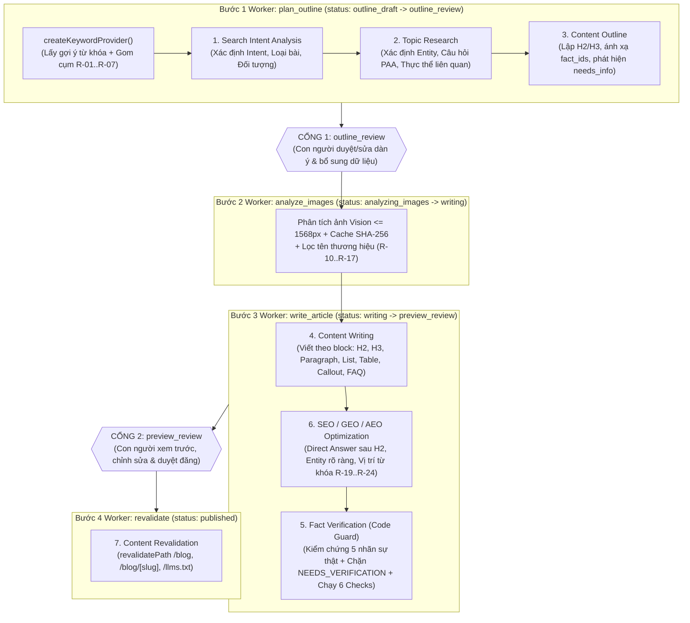

# PHASE 1 — THIẾT KẾ AI WRITING ENGINE (CONTENT SEO AGENT V2)

> **Ngày thiết kế**: 2026-11-18
> **Mục tiêu**: Nâng cấp năng lực nghiên cứu, lập dàn ý, viết bài chuẩn SEO/GEO/AEO và kiểm chứng dữ kiện 5 mức cho Content SEO Agent mà **không thay đổi cơ sở dữ liệu, không tạo thêm Worker rời rạc, và giữ nguyên 100% cơ chế bảo vệ 2 cổng duyệt + 6 kiểm tra tự động hiện có**.

---

## 1. Kiến Trúc Tổng Thể AI Writing Engine

### 1.1. Nguyên Tắc Thiết Kế
1. **Không tách nhiều AI Agent / nhiều Worker độc lập**:
   - Thay vì gọi 6–7 lượt LLM nối tiếp nhau cho mỗi bài viết (gây tốn kém token gấp 5 lần và tăng nguy cơ timeout 60s của Serverless Function), AI Writing Engine tổ chức thành **các module hàm độc lập (composable tasks)** nằm trong `lib/writing-engine/`, nhưng khi thực thi trên Worker sẽ được **tích hợp gọn vào đúng 2 bước gọi LLM sẵn có** (`plan_outline` và `write_article`).
2. **Bảo toàn 100% hợp đồng dữ liệu cũ (Backward Compatibility)**:
   - Mọi trường dữ liệu mới trong `outline`, `content_blocks`, `seo` đều là trường tùy chọn (`.optional()`) để bài viết V1 đã xuất bản vẫn hiển thị và vượt qua toàn bộ 20 bài kiểm thử hiện tại.
3. **Tách biệt Suy luận AI và Kiểm định bằng Code (`R-34`)**:
   - AI đề xuất nội dung và gắn nhãn dữ kiện (`VERIFIED`, `USER_PROVIDED`, `GENERAL_KNOWLEDGE`, `NEEDS_VERIFICATION`, `OPINION`); nhưng **chỉ có Code TypeScript** mới có quyền xác nhận một dữ kiện là `VERIFIED` (khi đối chiếu khớp `fact_ids` trong `brand_profile`) hoặc chặn bài viết khi phát hiện `NEEDS_VERIFICATION`.

### 1.2. Cấu Trúc Thư Mục Module Dự Kiến

```text
lib/
├── writing-engine/
│   ├── index.ts                # Điểm vào chính của AI Writing Engine
│   ├── types.ts                # Zod Schemas cho 7 năng lực & 5 nhãn dữ kiện (Evidentiary Labels)
│   ├── prompts.ts              # Bộ Prompt có gắn phiên bản (PROMPT_REGISTRY v2.0.0)
│   ├── intent-research.ts      # Năng lực 1 & 2: Search Intent Analysis & Topic Research
│   ├── outline-architect.ts    # Năng lực 3: Content Outline Builder
│   ├── article-writer.ts       # Năng lực 4 & 6: Content Writing + SEO/GEO/AEO Optimization
│   └── fact-verifier.ts        # Năng lực 5: Fact Verification & Truth Classification Guard
```

### 1.3. Ánh Xạ 7 Năng Lực Mục Tiêu Vào Luồng Worker Hiện Tại



---

## 2. Cách Tích Hợp Vào Worker Hiện Tại (`lib/agent/worker.ts`)

Không thay đổi chữ ký hàm `processNextAgentJob()` hay các hằng số trạng thái trong `lib/agent/worker.ts`. Cách tích hợp cụ thể:

1. **Trong `handlePlanOutline(article, brand)`**:
   - Đọc thêm ghi chú yêu cầu sửa gần nhất của Editor từ bảng `article_events` (nếu bài viết bị trả về từ `outline_review` → `outline_draft`).
   - Gọi `buildPlanOutlinePrompt()` từ `lib/writing-engine/prompts.ts` (tích hợp **Năng lực 1: Search Intent**, **Năng lực 2: Topic Research**, **Năng lực 3: Content Outline** trong 1 lần gọi `llm.generateStructured` duy nhất).
   - Chạy hàm hậu kiểm `verifyOutlineFacts(res.data, brand)` từ `lib/writing-engine/fact-verifier.ts`:
     - Nếu mục H2 nào tham chiếu `fact_id` không có trong `brand_profile.facts` hoặc được gắn nhãn `NEEDS_VERIFICATION`, tự động chuyển thông tin đó vào mảng `needs_info`.
2. **Trong `handleAnalyzeImages(article, brand)`**:
   - Giữ nguyên 100% logic hiện tại (đã đạt chuẩn `R-10` → `R-17`).
3. **Trong `handleWriteArticle(article, brand)`**:
   - Đọc thêm ghi chú yêu cầu sửa gần nhất của Editor từ `article_events` (nếu bài viết bị trả về từ `preview_review` → `writing`).
   - Gọi `buildWriteArticlePrompt()` từ `lib/writing-engine/prompts.ts` (tích hợp **Năng lực 4: Content Writing** và **Năng lực 6: SEO/GEO/AEO Optimization**).
   - Chạy **Năng lực 5: Fact Verification** (`verifyArticleClaimsAndEnforceTruthLabels`) trước khi chạy `runAllArticleChecks()`:
     - Kiểm tra mọi block có nhãn `VERIFIED`: bắt buộc phải có `fact_ids` hợp lệ trong `brand_profile`. Nếu AI tự gắn `VERIFIED` mà không có `fact_ids` thật, code tự động hạ nhãn xuống `NEEDS_VERIFICATION` và đẩy cảnh báo vào `needs_info`.
     - Mọi block có nhãn `NEEDS_VERIFICATION` đều tự động thêm mục tương ứng vào `needs_info`, khiến kiểm tra #6 (`checkNeedsInfoEmpty`) chặn bài viết ở trạng thái `writing` và hiển thị rõ cho Editor biết cần bổ sung gì.
4. **Trong nhánh `step === "revalidate"`**:
   - Thực thi **Năng lực 7: Content Revalidation**: làm mới `/blog`, `/blog/${article.slug}` và `/llms.txt`.

---

## 3. Thiết Kế Hệ Thống Nhãn Dữ Kiện & Kiểm Chứng Sự Thật (Năng lực 5)

### 3.1. Định Nghĩa 5 Nhãn Dữ Kiện (`ClaimClassification`)

```typescript
export const ClaimLabelValues = [
  "VERIFIED",           // Dữ kiện đã xác thực từ brand_profile.facts hoặc brand_profile.products
  "USER_PROVIDED",      // Dữ kiện do người dùng/Editor nhập trực tiếp trong dàn ý hoặc yêu cầu bài viết
  "GENERAL_KNOWLEDGE",  // Kiến thức phổ thông, định nghĩa chuyên ngành có thể kiểm chứng độc lập
  "NEEDS_VERIFICATION", // Chưa đủ căn cứ trong brand_profile -> BẮT BUỘC hỏi người dùng / chặn xuất bản
  "OPINION",            // Nhận định, góc nhìn tư vấn hoặc đánh giá chủ quan hợp lý (không chứa forbidden_claims)
] as const;

export type ClaimLabel = (typeof ClaimLabelValues)[number];
```

### 3.2. Quy Tắc Cứng Chống Giả Mạo Nhãn Sự Thật (`Truth Guard`)
Để đảm bảo nguyên tắc **"Không cho phép AI tự chuyển `NEEDS_VERIFICATION` thành `VERIFIED` nếu không có nguồn hoặc dữ kiện xác thực"**, module `lib/writing-engine/fact-verifier.ts` thực thi 4 chốt chặn bằng code TypeScript:

1. **Chốt chặn 1 — Xác thực nhãn `VERIFIED` bằng `fact_ids`**:
   - Một block hoặc câu khẳng định chỉ được giữ nhãn `VERIFIED` khi và chỉ khi `fact_ids` của nó không rỗng và **mọi `fact_id` đều tồn tại trong `brand_profile.facts`** (hoặc khớp thông số `brand_profile.products`).
   - Nếu AI trả về `claim_label: "VERIFIED"` nhưng `fact_ids` rỗng hoặc chứa ID không tồn tại → Code cưỡng bức chuyển `claim_label` thành `"NEEDS_VERIFICATION"` và ghi vào `needs_info`.
2. **Chốt chặn 2 — Bảo toàn danh sách `needs_info` từ Bước Dàn Ý**:
   - Nếu ở bước `plan_outline`, một thông tin đã bị đánh dấu vào `outline.needs_info` (tương ứng `NEEDS_VERIFICATION`), và trước khi viết bài `brand_profile` vẫn chưa được cập nhật thêm `fact` mới liên quan và Editor chưa xóa mục đó khỏi `needs_info`, thì ở bước `write_article` code sẽ giữ nguyên cảnh báo `needs_info` đó dù AI có cố tình bỏ trống `needs_info` trong phản hồi.
3. **Chốt chặn 3 — Kiểm soát số liệu thương hiệu vs Kiến thức phổ thông (`GENERAL_KNOWLEDGE`)**:
   - Bất kỳ đoạn văn nào có nhắc tới tên thương hiệu (`brand.brand_name`) hoặc tên sản phẩm (`brand.products[].name`) mà chứa con số (giá bán, công suất, kích thước, năm bảo hành...) đều bắt buộc phải nằm trong tập số liệu cho phép của `brand_profile` (`checkBrandFactsAndForbiddenClaims`). AI không được phép lách luật bằng cách gắn nhãn `GENERAL_KNOWLEDGE` hay `OPINION` cho câu chứa tên sản phẩm của thương hiệu.
4. **Chốt chặn 4 — Cấm tuyệt đối `forbidden_claims` trên mọi nhãn**:
   - Dù đoạn văn mang nhãn `OPINION` hay `USER_PROVIDED`, nếu xuất hiện cụm từ trong `brand.forbidden_claims` thì vẫn bị chặn cứng bởi `checkBrandFactsAndForbiddenClaims` (`R-18`, `R-32`).

---

## 4. Thiết Kế Prompt Có Phiên Bản & Độc Lập (`lib/writing-engine/prompts.ts`)

Mỗi prompt được quản lý qua đối tượng `PromptTemplate` có `id`, `version`, `ruleSteps` để dễ dàng kiểm thử độc lập và theo dõi trong `ai_runs.step`:

```typescript
export interface PromptTemplate {
  id: "intent_and_outline" | "image_vision" | "seo_geo_aeo_writer";
  version: string; // Ví dụ: "2.0.0"
  ruleSteps: RuleStep[];
  buildSystemPrefix: (brand: BrandProfileRow) => string;
  buildUserPrompt: (context: Record<string, unknown>) => string;
}
```

### 4.1. Prompt 1: `intent_and_outline` (`v2.0.0`)
- **Năng lực đảm nhiệm**: (1) Search Intent Analysis + (2) Topic Research + (3) Content Outline.
- **System Prefix (Được Cache theo `R-16`)**:
  - Vai trò: Chuyên gia Chiến lược SEO/GEO/AEO & Kiến trúc Nội dung.
  - Quy tắc nạp tự động: `loadRules("plan")`.
  - Nguồn sự thật duy nhất: JSON `brand_profile` (`brand_name`, `description`, `voice`, `products`, `facts`, `forbidden_claims`).
- **User Prompt**:
  - Đầu vào: `topic`, danh sách gợi ý từ khóa đã loại trùng (tối đa 30 từ khóa kèm `intentCluster`), và `editor_note` (nếu Editor yêu cầu lập lại dàn ý).
  - Yêu cầu thực thi:
    1. **Phân tích Search Intent**: Xác định `search_intent` (`informational` | `commercial` | `transactional` | `navigational`), `content_type` (`guide` | `knowledge` | `product` | `comparison` | `service` | `news`), và mục tiêu chuyển đổi hợp lý.
    2. **Nghiên cứu Chủ đề & Thực thể (GEO)**: Chọn `primary_keyword`, tối đa 8 `secondary_keywords`, tối đa 6 câu hỏi `faq_questions` sát nhu cầu thực tế.
    3. **Xây dựng Dàn ý (Outline)**: Tối thiểu 2–7 mục H2 (kèm gợi ý H3 nếu cần). Mỗi mục H2 phải chỉ rõ `direct_answer_hint` (gợi ý câu trả lời trực tiếp cho AEO), `key_points`, `fact_ids` (chỉ lấy ID có thật trong `brand_profile.facts`) và `claim_label`.
    4. **Kiểm soát sự thật**: Nếu chủ đề yêu cầu thông tin chưa có trong `brand_profile` (bảo hành, đổi trả, giá khuyến mãi, chứng nhận...), bắt buộc gắn `claim_label = "NEEDS_VERIFICATION"` và liệt kê cụ thể vào `needs_info`.

### 4.2. Prompt 2: `seo_geo_aeo_writer` (`v2.0.0`)
- **Năng lực đảm nhiệm**: (4) Content Writing + (5) Fact Verification (Self-Tagging) + (6) SEO/GEO/AEO Optimization.
- **System Prefix (Được Cache theo `R-16`)**:
  - Vai trò: Website Content Standard Agent (SEO, GEO, AEO, E-E-A-T).
  - Quy tắc nạp tự động: `loadRules(["write", "schema"])`.
  - Nguồn sự thật duy nhất: JSON `brand_profile`.
- **User Prompt**:
  - Đầu vào: `topic`, `primary_keyword`, `secondary_keywords`, `faq_questions`, `outline` đã được Editor duyệt tại Cổng 1, danh sách `assets` ảnh đã phân tích, `editor_note` (nếu bị trả về từ Cổng 2), và `retry_errors` (nếu lần kiểm tra tự động trước bị trượt).
  - Yêu cầu thực thi:
    1. **SEO On-page (`R-19`, `R-20`)**:
       - `seo.title`: 10–60 ký tự, chứa nguyên văn `primary_keyword`.
       - `seo.meta_description`: 30–155 ký tự, nêu rõ lợi ích thực tế.
       - Đoạn mở đầu (Sapo — trong 100 từ đầu tiên) chứa nguyên văn `primary_keyword` và trả lời thẳng vấn đề chính.
    2. **Công thức AEO (`R-21`, `R-29`)**:
       - Ngay sau mỗi thẻ `h2` bắt buộc là một block `paragraph` trả lời trực tiếp 1–2 câu (CÂU HỎI/CHỦ ĐỀ → TRẢ LỜI TRỰC TIẾP → GIẢI THÍCH → DẪN CHỨNG).
       - Các block `faq` trả lời độc lập, rõ ràng (từ 5 đến dưới 300 từ).
    3. **Chuẩn GEO (`R-22`)**:
       - Xác định rõ chủ thể (Entity: thương hiệu, sản phẩm, thông số).
       - Trình bày dữ liệu có cấu trúc bằng danh sách (`list`), bảng biểu (`table` khi so sánh/liệt kê thông số) hoặc khối điểm nhấn (`callout`).
    4. **Gắn nhãn dữ kiện (`claim_label` & `fact_ids`)**:
       - Mọi block có khẳng định về thương hiệu/sản phẩm phải gắn `claim_label: "VERIFIED"` kèm đúng `fact_ids`.
       - Kiến thức chung không nói về sản phẩm của thương hiệu gắn `claim_label: "GENERAL_KNOWLEDGE"`.
       - Nếu phát hiện yêu cầu nào chưa có dữ kiện trong `brand_profile`, tuyệt đối không bịa mà ghi vào `needs_info`.

---

## 5. Định Dạng Đầu Vào & Đầu Ra (Tương Thích Ngược 100%)

### 5.1. Mở Rộng Tương Thích Ngược `OutlineItemSchema` & `ArticleOutlinePayloadSchema`

```typescript
export const SearchIntentValues = [
  "informational",
  "commercial",
  "transactional",
  "navigational",
] as const;

export const OutlineItemV2Schema = z.object({
  h2: z.string().min(1),
  h3_items: z.array(z.string().min(1)).optional(),          // Tùy chọn cho V2
  direct_answer_hint: z.string().optional(),                // Gợi ý câu trả lời trực tiếp AEO
  key_points: z.array(z.string().min(1)).min(1),
  fact_ids: z.array(z.string().min(1)),
  claim_label: z.enum(ClaimLabelValues).optional(),         // Nhãn dữ kiện của mục
});

export const ArticleOutlinePayloadV2Schema = z.object({
  search_intent: z.enum(SearchIntentValues).optional(),
  content_type: z.string().optional(),
  items: z.array(OutlineItemV2Schema),
  needs_info: z.array(z.string()).default([]),
  prompt_version: z.string().optional(),
});
```
> *Lưu ý*: Dữ liệu `OutlineItem` cũ chỉ có `{ h2, key_points, fact_ids }` hoàn toàn hợp lệ khi parse qua `OutlineItemV2Schema`.

### 5.2. Mở Rộng Tương Thích Ngược `ContentBlockSchema`

Giữ nguyên 6 loại block hiện tại (`h2`, `paragraph`, `list`, `image`, `faq`, `callout`), bổ sung trường tùy chọn `claim_label?: ClaimLabel` và hỗ trợ thêm 2 loại block chuẩn cho bài viết chuyên sâu (`h3`, `table`):

```typescript
// Bổ sung tùy chọn vào union ContentBlockSchema (không phá vỡ 6 loại cũ):
z.object({
  type: z.literal("h3"),
  text: z.string().min(1),
}),
z.object({
  type: z.literal("table"),
  caption: z.string().optional(),
  headers: z.array(z.string().min(1)).min(1),
  rows: z.array(z.array(z.string())).min(1),
  fact_ids: z.array(z.string()).optional(),
  claim_label: z.enum(ClaimLabelValues).optional(),
}),
```
> *Lưu ý*: `<ArticleRenderer>` và `extractBodyPlainText()` trong `lib/checks/index.ts` sẽ được bổ sung nhánh render/trích xuất văn bản cho `h3` và `table` để tìm kiếm, đếm từ và kiểm tra `forbidden_claims` hoạt động xuyên suốt.

---

## 6. Xử Lý Lỗi, Retry & Kiểm Soát Chi Phí AI

### 6.1. Xử Lý Lỗi & Retry Thông Minh (`R-34`)
1. **Ở mức độ bước `write_article` (Self-Correction Retry)**:
   - Khi `runAllArticleChecks()` phát hiện lỗi kỹ thuật có thể sửa được bằng AI (ví dụ: `seo.title` dài 63 ký tự vượt ngưỡng 60 ký tự, hoặc thiếu `primary_keyword` trong 100 từ đầu), Worker cho phép thử lại tối đa `WRITER_CHECK_MAX_RETRIES = 1` lần với danh sách lỗi cụ thể truyền vào prompt.
   - **Không Retry khi thiếu dữ liệu thật (`needs_info.length > 0`)**: Nếu bài trượt do thiếu dữ kiện trong `brand_profile` (`NEEDS_VERIFICATION`), vòng lặp dừng ngay lập tức ở lần thử đầu tiên (`attempt = 0`), giữ bài ở `writing` và hiển thị thông báo rõ ràng cho Editor để tiết kiệm 100% token retry vô ích.
2. **Ở mức độ hàng đợi `pgmq` (`WORKER_MAX_RETRIES = 3`)**:
   - Nếu lỗi mạng hoặc nhà cung cấp AI quá tải, thông điệp trong `agent_jobs` chưa bị `ack` và sẽ tự động hiển thị lại sau Visibility Timeout (120 giây).
   - Nếu `read_ct > 3`, Worker tự động `ack` job và ghi chi tiết vào `articles.last_error` để tránh vòng lặp vô hạn làm cạn ngân sách token.

### 6.2. Kiểm Soát Chi Phí AI (`R-03`, `R-10`, `R-13`, `R-16`, `R-38`, `R-42`)
1. **Kiểm tra ngân sách cứng trước mỗi lần gọi (`assertTokenBudgetAvailable`)**:
   - Gọi RPC `ai_tokens_used_this_month()` so sánh với `ai_settings.monthly_token_budget`. Nếu vượt ngân sách, chặn ngay trước khi gửi request tới LLM.
2. **Prompt Caching (`R-16`)**:
   - Đặt toàn bộ phần cố định (`loadRules(...)` + `brand_profile` JSON) vào `systemCacheablePrefix` với `cacheControl: { type: "ephemeral" }`.
3. **Nạp quy tắc chọn lọc (`loadRules`)**:
   - Bước `plan_outline` chỉ nạp các quy tắc gắn thẻ `[plan]`; bước `analyze_images` chỉ nạp `[image]`; bước `write_article` chỉ nạp `[write, schema]`.
4. **Gộp nhiệm vụ thông minh (Zero Extra LLM Calls)**:
   - Toàn bộ 7 năng lực được thực hiện chỉ với **2 lần gọi Text LLM** (`plan_outline` và `write_article`) + **N lần gọi Vision LLM** (có cache `sha256` 0 token cho ảnh trùng). Tuyệt đối không phát sinh thêm cuộc gọi LLM phụ cho Fact Checker hay SEO Scorer vì phần kiểm định được thực thi 100% bằng code TypeScript (0 token).

---

## 7. Kế Hoạch Kiểm Thử Cho Từng Nhiệm Vụ (Phase 1 Test Suite)

Khi triển khai Phase 1, ngoài việc giữ xanh toàn bộ 6 file test hiện có (`20/20 tests`), sẽ bổ sung file kiểm thử mới `tests/writing-engine.test.ts` gồm 7 nhóm kịch bản:

1. **Test Năng lực 1 & 2 (`intent-research`)**:
   - Kiểm tra phân loại đúng `search_intent` (`informational` vs `commercial`) và gom cụm từ khóa từ chủ đề đầu vào.
2. **Test Năng lực 3 (`outline-architect`)**:
   - Kiểm tra dàn ý sinh ra có đủ `h2`, `key_points`, `fact_ids` hợp lệ và tự động tách các yêu cầu ngoài `brand_profile` vào `needs_info`.
3. **Test Năng lực 4 (`article-writer` & Mở rộng Block `h3`, `table`)**:
   - Kiểm tra `ContentBlockSchema` parse thành công cả bài viết V1 (6 loại block cũ) lẫn bài viết V2 (có thêm `h3`, `table`, `claim_label`).
   - Kiểm tra `<ArticleRenderer>` render đúng thẻ `<h3>` và `<table>` mà không làm thay đổi giao diện các bài viết cũ.
4. **Test Năng lực 5 (`fact-verifier` — Chống tự nâng `NEEDS_VERIFICATION` thành `VERIFIED`)**:
   - **Bẫy 1**: Giả lập AI trả về một block có `claim_label: "VERIFIED"` nhưng `fact_ids: []` hoặc `fact_ids: ["fact-999-khong-ton-tai"]` → Hàm `verifyArticleClaimsAndEnforceTruthLabels()` phải tự động hạ xuống `NEEDS_VERIFICATION` và đẩy lỗi vào `needs_info` khiến `runAllArticleChecks` trả về `passed: false`.
   - **Bẫy 2**: Giả lập bài viết có `needs_info` từ bước `plan_outline` nhưng AI tự ý xóa trống `needs_info` ở bước `write_article` → Code vẫn giữ nguyên `needs_info` chưa được giải quyết và chặn chuyển sang `preview_review`.
   - **Bẫy 3**: Đoạn văn gắn nhãn `GENERAL_KNOWLEDGE` (không nhắc tên thương hiệu/sản phẩm) chứa con số phổ thông (ví dụ: "pha với 200 ml nước ở 90 độ C") được phép đi qua, nhưng nếu đoạn văn nhắc tới "LumiBrew Mini X1" kèm con số lạ "áp suất 19 bar" (sai lệch so với 15 bar trong `brand_profile`) thì bị chặn ngay lập tức.
5. **Test Năng lực 6 (`seo-geo-aeo-optimization`)**:
   - Kiểm tra Direct Answer sau thẻ H2, vị trí từ khóa chính và Schema JSON-LD.
6. **Test Năng lực 7 (`revalidation` & Phản hồi Editor)**:
   - Kiểm tra khi Editor trả bài từ Cổng 1/Cổng 2 kèm `note`, prompt sinh ra cho lần chạy lại có chứa nguyên văn `note` của Editor.
7. **Test Hồi quy (`compliance.test.ts` & `e2e-workflow.test.ts`)**:
   - Đảm bảo 100% bài test hiện có đều PASS.

---

## 8. Kế Hoạch Triển Khai An Toàn (Bước Tiếp Theo Sau Khi Duyệt)

1. **Bước 1**: Mở rộng tương thích ngược `lib/supabase/types.ts` và `components/ArticleRenderer.tsx` (thêm tùy chọn `claim_label`, `search_intent`, `h3`, `table`).
2. **Bước 2**: Xây dựng bộ module `lib/writing-engine/` (`types.ts`, `prompts.ts`, `fact-verifier.ts`, `index.ts`).
3. **Bước 3**: Cập nhật nhẹ `lib/checks/index.ts` và `lib/agent/worker.ts` để tích hợp `lib/writing-engine/` và truyền `note` của Editor từ `article_events` vào prompt.
4. **Bước 4**: Viết và chạy toàn bộ bộ test (`tests/writing-engine.test.ts` + 6 file test hồi quy) và `npm run typecheck`.

